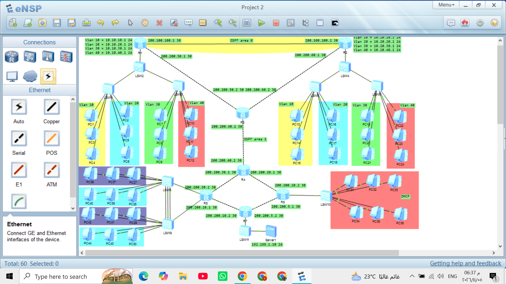
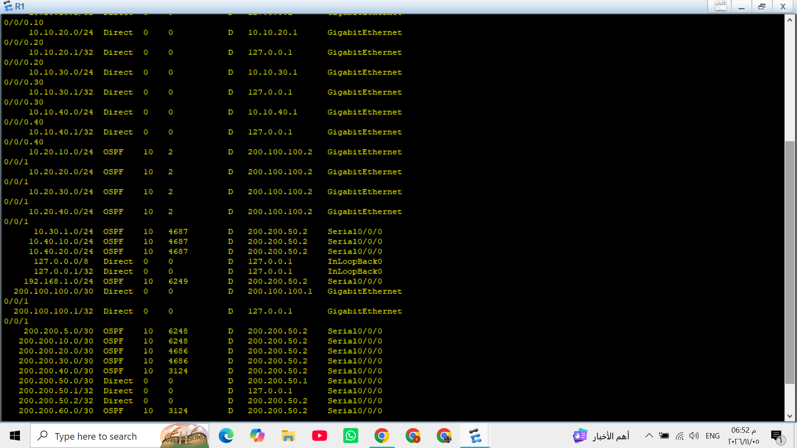
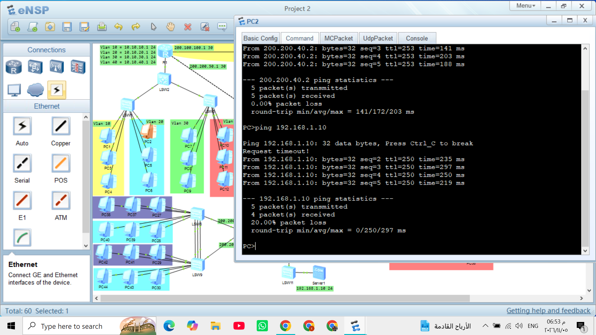

# Enterprise Multi-Branch Network Infrastructure (eNSP Solution)

An enterprise-grade, highly available network topology designed, simulated, and validated using **Huawei eNSP**. This project connects four distinct branches alongside an external WAN Server farm, implementing resilient Layer 2 aggregation, inter-VLAN routing, dynamic multi-area routing, and automated dynamic addressing.

---

## 📸 Topology Overview

Below is the complete network topology layout designed in Huawei eNSP, showcasing the core routers, aggregation switches, access switches, dynamic VLAN segments, and WAN Server deployment:



---

## 📌 Architecture Highlights & Core Technologies

1. **Multi-Area OSPF Dynamic Routing**:
   * Scalable dynamic routing architecture divided into multiple OSPF areas to reduce SPF recalculations and optimize routing tables across primary and extension routers.
   
2. **Eth-Trunk (Link Aggregation)**:
   * Aggregated physical links between switches and routers using **Eth-Trunk** (Manual/LACP mode) to double interface throughput, eliminate MAC/Port flapping, and provide hardware-level redundancy.

3. **VLAN Segmentation & Trunking**:
   * Logical traffic separation using IEEE 802.1Q VLAN encapsulation across access and core links (`port link-type trunk`).

4. **Router-on-a-Stick (RoaS)**:
   * Inter-VLAN routing enabled using logical sub-interfaces on gateway routers, terminating 802.1Q tags to allow inter-departmental communication.

5. **Centralized & Automated DHCP**:
   * Automated IP address pool distribution across client VLANs and branch endpoints.

6. **External WAN Server**:
   * Dedicated hosting segment representing an external corporate/Internet WAN Server (`192.168.1.10/24`), tested for full end-to-end routing reachability.

---

## 📐 Network Branch Structure & Segmentation

The infrastructure consists of four primary branches, categorized by their VLAN density and operational scope:

| Branch / Segment | VLAN Configuration | Addressing Strategy | Services Enabled |
| :--- | :--- | :--- | :--- |
| **Branch 1** | 4 Custom VLANs (VLAN 10, 20, 30, 40) | Multi-subnet addressing via RoaS | DHCP, Eth-Trunk Aggregation |
| **Branch 2** | 4 Custom VLANs (VLAN 10, 20, 30, 40) | Multi-subnet addressing via RoaS | DHCP, Eth-Trunk Aggregation |
| **Branch 3** | Default VLAN (VLAN 1) | Single Subnet allocation | Dynamic DHCP Distribution |
| **Branch 4** | 2 Custom VLANs | Segmented Subnets | Inter-VLAN Routing & DHCP |
| **WAN Server Farm** | Dedicated Server Subnet | Static IP (`192.168.1.0/24`) | Web/Data Hosting |

---

## 🛠️ Key Implementation Configurations (Huawei VRP)

### 1. Eth-Trunk Configuration (Link Aggregation)
```huawei
<Huawei> system-view
[Huawei] interface Eth-Trunk 1
[Huawei-Eth-Trunk1] mode manual load-balance
[Huawei-Eth-Trunk1] port link-type trunk
[Huawei-Eth-Trunk1] port trunk allow-pass vlan all
[Huawei-Eth-Trunk1] quit

# Adding physical links to the Eth-Trunk
[Huawei] interface GigabitEthernet 0/0/1
[Huawei-GigabitEthernet0/0/1] eth-trunk 1
[Huawei] interface GigabitEthernet 0/0/2
[Huawei-GigabitEthernet0/0/2] eth-trunk 1
```

### 2. Router-on-a-Stick (Sub-interfaces)
```huawei
[Huawei] interface GigabitEthernet 0/0/1.10
[Huawei-GigabitEthernet0/0/1.10] dot1q termination vid 10
[Huawei-GigabitEthernet0/0/1.10] ip address 10.10.10.1 255.255.255.0
[Huawei-GigabitEthernet0/0/1.10] arp broadcast enable

[Huawei] interface GigabitEthernet 0/0/1.20
[Huawei-GigabitEthernet0/0/1.20] dot1q termination vid 20
[Huawei-GigabitEthernet0/0/1.20] ip address 10.10.20.1 255.255.255.0
[Huawei-GigabitEthernet0/0/1.20] arp broadcast enable
```

### 3. Multi-Area OSPF Configuration
```huawei
[Huawei] ospf 1 router-id 1.1.1.1
[Huawei-ospf-1] area 0.0.0.0
[Huawei-ospf-1-area-0.0.0.0] network 200.200.100.0 0.0.0.3
[Huawei-ospf-1-area-0.0.0.0] quit
[Huawei-ospf-1] area 0.0.0.1
[Huawei-ospf-1-area-0.0.0.1] network 200.200.40.0 0.0.0.3
```

---

## 🔍 Verification & Testing

### 1. OSPF Neighbor Validation
Validation of dynamic adjacency establishment across multiple areas:



```huawei
display ospf peer brief
display ip routing-table
```

### 2. Multi-IP & Multi-VLAN Ping Verification
End-to-end reachability verification between clients in different VLANs across remote branches and the WAN Server (`192.168.1.10`):



---

## 🚀 How to Run in eNSP

1. Install **Huawei eNSP** along with required dependencies (WinPcap, Wireshark, VirtualBox).
2. Clone this repository:
   ```bash
   git clone https://github.com/your-username/enterprise-ensp-network.git
   ```
3. Create an `images/` directory in the repository folder and place your screenshots as follows:
   * `images/topology.png` (Full Topology)
   * `images/ospf_verification.png` (OSPF Status)
   * `images/ping_test.png` (Ping Results)
4. Launch `Project 2.topo` in eNSP.
5. Start all nodes and verify connectivity via CLI.
